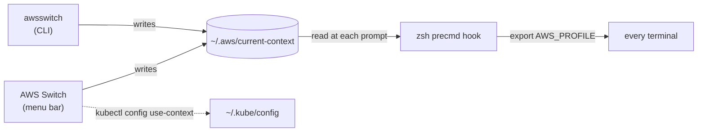

<div align="center">

# AWS Switch

**Switch the AWS profile for every terminal at once, from the macOS menu bar.**

[](https://github.com/pict0/aws-switch/releases/latest)
[](https://github.com/pict0/aws-switch/actions/workflows/ci.yml)
[](https://scorecard.dev/viewer/?uri=github.com/pict0/aws-switch)


[](LICENSE)

[Install](#install) · [How it works](#how-it-works) · [Command line](#command-line) · [Security](#security-model) · [Contributing](CONTRIBUTING.md)

</div>

---

## Features

- 🖥️ **One switch, every terminal.** Pick a profile in the menu bar and every open shell picks it up at its next prompt.
- 🚦 **Production stands out.** Profiles are grouped by environment tier, production is the only thing coloured red, and switching to it always asks first.
- ☸️ **kubectl follows along.** Changing the AWS profile also switches to the matching EKS context.
- 📌 **Pin a terminal.** Keep one shell on its own profile while the rest follow the global one.
- 🔑 **SSO-aware.** Shows when your SSO session expires and hands sign-in to `aws sso login`.
- 🔒 **Nothing leaves your Mac.** No network access, no credentials, no dependencies, no telemetry.

## Install

1. Download `AWSSwitch-<version>.pkg` from the [latest release](https://github.com/pict0/aws-switch/releases/latest). It's a universal build for Apple silicon and Intel, macOS 14 or later.
2. The package is unsigned, so the first time, **right-click it and choose Open** (or allow it in System Settings → Privacy & Security).
3. Open a new terminal.

<details>
<summary><b>What the installer changes</b></summary>

<br>

- Installs `/Applications/AWS Switch.app`.
- Installs the shell hook to `/usr/local/share/aws-switch/aws-switch.zsh`.
- Appends `source /usr/local/share/aws-switch/aws-switch.zsh` to the logged-in user's `~/.zshrc`, after backing it up to `~/.zshrc.bak-aws-switch-<timestamp>`. It skips this if `.zshrc` already sources an `aws-switch.zsh`.

</details>

<details>
<summary><b>Verify a download</b></summary>

<br>

Every release has a build-provenance attestation, which proves the package was built from this repo by its release workflow:

```sh
gh attestation verify AWSSwitch-<version>.pkg --repo pict0/aws-switch
```

Each release also includes `SHA256SUMS`.

</details>

## How it works



- **Next prompt, not mid-command.** A command that's already running, such as `terraform apply`, keeps the environment it started with.
- **Every switch is logged** to `~/Library/Logs/AWSSwitch/switch.log`.

### Environment tiers

Tiers are inferred from whole tokens in the profile name, split on `-`, `_` and `.`, so `product-catalogue` is not production.

| Tier | Menu symbol | Matching name tokens | Confirmation |
|---|---|---|---|
| **Production** | Red warning triangle, plus a red menu bar pill | `prod`, `production`, `prd` | ✅ Always |
| **Pre-production** | Half-filled circle | `staging`, `stage`, `stg`, `uat`, `preprod`, `pre-prod`, `dev`, `development`, `test`, `qa`, `sandbox`, `sbx` | — |
| **Shared** | Empty circle | anything else | — |

### kubectl

When the AWS profile changes (from the menu, or from `awsswitch` while the app is running), kubectl switches to the EKS context whose cluster ARN belongs to that profile's account.

- It switches only when **exactly one** context matches. Otherwise kubectl is left alone.
- The kubectl context lives in `~/.kube/config`, so every terminal sees the change straight away.
- Contexts can also be picked directly from the Kubernetes submenu, and production ones ask for confirmation.
- Auto-switching can be turned off in the menu.

## Command line

The shell hook adds an `awsswitch` command that writes the same context file as the app:

| Command | What it does |
|---|---|
| `awsswitch <profile>` | Runs `aws sso login`, then switches every terminal |
| `awsswitch --no-login <profile>` | Switches without signing in |
| `awsswitch --pin <profile>` | Pins this terminal to a profile; it stops following the global one |
| `awsswitch --unpin` | Rejoins the global context |
| `awsswitch` | Shows the current profile and whether this terminal is pinned |

## Security model

| | |
|---|---|
| 🌐 **No network, no credentials** | The app reads `~/.aws/config` and writes one file. SSO sign-in is handed to `aws sso login`. |
| 🎟️ **SSO cache** | Only `startUrl` and `expiresAt` are read. Token fields are never decoded. |
| 🧱 **No shell injection** | The app, CLI and hook all allow-list profile names (`[A-Za-z0-9._-]`), so the context file can't inject anything into a shell. |
| 📝 **Your config is left alone** | `~/.aws/config` and the `[default]` profile are never modified. |
| ☸️ **kubectl only via kubectl** | The app only runs `kubectl config view -o json`, which redacts credentials, and `kubectl config use-context`. It never parses or writes kubeconfig itself. |
| 📦 **Nothing extra** | No dependencies, no auto-update, no telemetry. |

Found a vulnerability? See [SECURITY.md](SECURITY.md).

## Build from source

Requires Xcode 16 or later.

```sh
swift test                      # run the core tests
scripts/bundle.sh --install     # universal .app, ad-hoc signed, in ~/Applications
scripts/package.sh              # installer: build/AWSSwitch-<version>.pkg
```

Then add the shell hook to `~/.zshrc`:

```zsh
source /path/to/aws-switch/shell/aws-switch.zsh
```

For day-to-day development, open `Package.swift` in Xcode or use `swift run AWSSwitch`. Launch at login only works from the `.app` bundle. See [CONTRIBUTING.md](CONTRIBUTING.md) for how PRs and releases work.

## Licence

[MIT](LICENSE)

<sub>AWS Switch is not affiliated with or endorsed by Amazon Web Services or The Linux Foundation. AWS and Kubernetes are trademarks of their respective owners.</sub>
